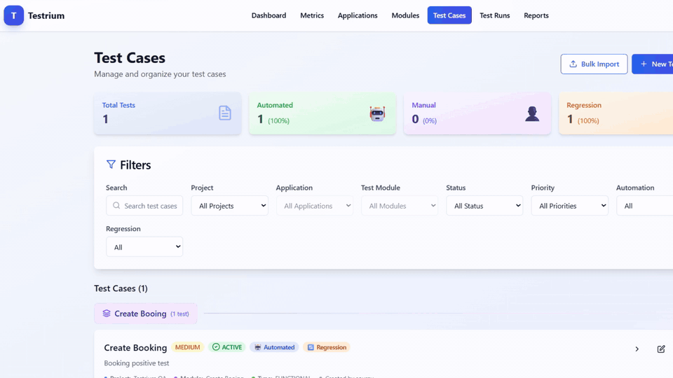
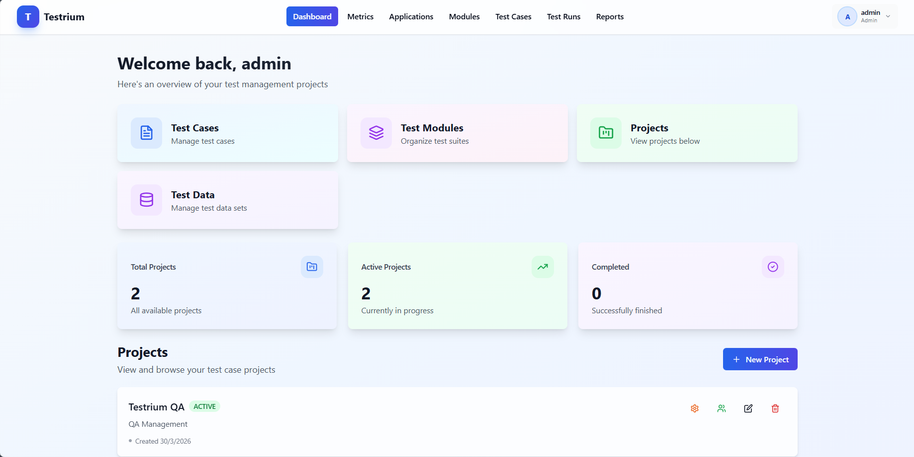
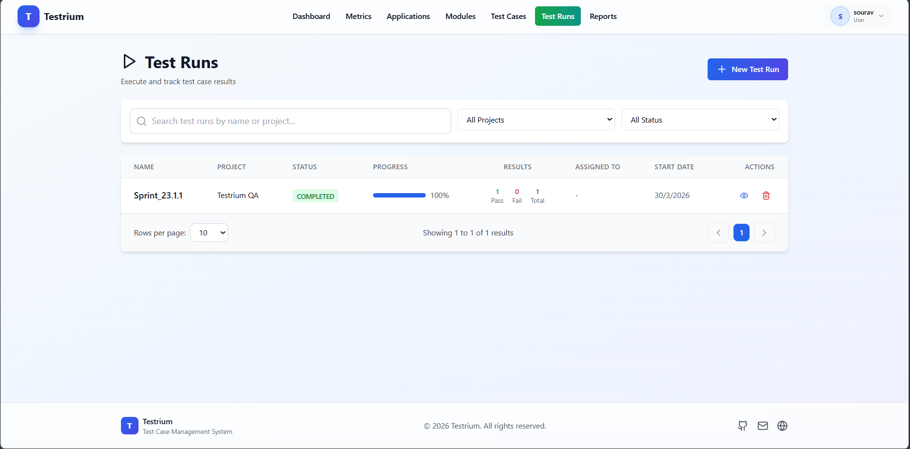

<div align="center">

# Testrium

**Open-source test case management for QA teams.**
Write test cases, run them in sprints, and see exactly what passed. Self-hosted, free, and up in one command.

[](./LICENSE.txt)


[**Documentation**](https://testrium.github.io/testrium/) ·
[**Quick start**](#quick-start) ·
[**Features**](#what-you-can-do) ·
[**Contributing**](#contributing) ·
[**Changelog**](./CHANGELOG.md)



</div>

---

## Quick start

All you need is [Docker](https://docs.docker.com/get-docker/). You don't need Java, Node.js or a database.

**1. Download the two config files**

```bash
mkdir testrium && cd testrium
curl -O https://raw.githubusercontent.com/testrium/testrium/master/docker-compose.yml
curl -o .env https://raw.githubusercontent.com/testrium/testrium/master/.env.example
```

**2. Set your secrets.** Open `.env` and change at least these three values:

| Setting | What to put there |
|---------|-------------------|
| `JWT_SECRET` | Any long random string (32+ characters) |
| `MYSQL_ROOT_PASSWORD` | A password for the database's root user |
| `MYSQL_PASSWORD` | A password for the app's database user |

**3. Start it**

```bash
docker compose up -d
```

**4. Open [http://localhost](http://localhost)** and create the admin account on the setup screen. That's it.

> The port comes from `APP_PORT` in `.env`, which is `80` by default. If port 80 is already taken, set `APP_PORT=8080` and open http://localhost:8080 instead.

To stop Testrium, run `docker compose down`. Your data stays in a Docker volume, so it's still there the next time you start it.

---

## What you can do

| | |
|---|---|
| 📝 **Test cases** | Write test cases with steps and expected results, organized by project and module. Tag them (smoke, regression…) and filter by priority, status or tag. |
| ▶️ **Test runs** | Group test cases into a run, assign it, and mark results one by one or in bulk. Progress updates as you go. |
| 📊 **Reports** | Pass/fail charts for every run. Export to PDF or Excel. |
| 🗂 **Overview** | KPIs and charts across all your projects, scoped to what each person can see. |
| 🐞 **JIRA** | Create a JIRA bug straight from a failed test. |
| 🔔 **Notifications** | Per-project email (SMTP) and Slack / Microsoft Teams alerts when runs are assigned or completed. |
| 📥 **Import & export** | Bulk-import test cases from Excel, and export them back out. |
| 🧪 **Test data** | Store test data per environment (DEV, QA, STAGING, PROD) and fetch it from your automation. |
| 🤖 **Automation API** | A REST API for Selenium, Playwright, RestAssured and other frameworks. |
| 🔐 **Roles** | Admins, leads and members, each with their own access. |
| 🌙 **Dark mode** | Across the whole app. |

<details>
<summary><b>Screenshots</b></summary>

### Dashboard


### Test Cases


### Test Runs


### Reports


</details>

---

## Documentation

The full docs are at **[testrium.github.io/testrium](https://testrium.github.io/testrium/)**.

| I want to… | Read |
|------------|------|
| Install with Docker, step by step | [Docker setup](https://testrium.github.io/testrium/guide/docker-setup) |
| Run it from source to hack on it | [Local development](https://testrium.github.io/testrium/guide/local-dev) |
| Change ports, the database, email or CORS | [Configuration](https://testrium.github.io/testrium/configuration/) |
| Learn each feature | [Features](https://testrium.github.io/testrium/features/) |
| Connect my automation framework | [API guide](https://testrium.github.io/testrium/api/) · [AUTOMATION_API_GUIDE.md](./AUTOMATION_API_GUIDE.md) |
| Import test cases from Excel | [BULK_IMPORT_GUIDE.md](./BULK_IMPORT_GUIDE.md) |
| Understand how the code is organized | [ARCHITECTURE.md](./ARCHITECTURE.md) |

---

## Contributing

New contributors are very welcome. You don't have to be an expert, and small fixes count.

**1. Pick something to work on.** Issues labeled [`good first issue`](https://github.com/testrium/testrium/labels/good%20first%20issue) are a good start. Comment on the issue so others know you're on it.

**2. Run it locally.** You need Java 17+, Maven 3.9+ and Node.js 18+. Run the backend and frontend in two terminals:

```bash
# Terminal 1: backend on http://localhost:8080 (uses a local H2 database, no MySQL needed)
cd backend
mvn spring-boot:run
```

```bash
# Terminal 2: frontend on http://localhost:5173
npm install
npm run dev
```

**3. Check your change** before opening a pull request:

```bash
npm run lint            # frontend lint
npm run build           # frontend build
cd backend && mvn test  # backend tests
```

**4. Open a pull request.** Fork the repo, create a branch, and open a PR against `master`. Use a [conventional commit](https://www.conventionalcommits.org/) title (`feat:`, `fix:`, `docs:`…). For user-facing changes, add a line to [CHANGELOG.md](./CHANGELOG.md) under `[Unreleased]`. CI builds the frontend, the backend and the Docker image on every PR.

<details>
<summary><b>Project layout</b></summary>

```
testrium/
├── backend/          Spring Boot API (Java 17, Spring Security + JWT, JPA)
│   └── src/main/java/com/testrium/manager/
│       ├── controller/   REST endpoints
│       ├── service/      business logic
│       ├── repository/   data access
│       ├── entity/       JPA entities
│       └── security/     auth and JWT
├── src/              React frontend (Vite, Tailwind CSS)
│   ├── pages/            one file per screen
│   ├── components/       shared UI
│   └── services/         API calls
├── docs/             documentation site (VitePress)
└── docker-compose.yml
```

</details>

---

## Roadmap

**Next up:** test case templates · reusable test suites · test case history · importing CI results (JUnit XML) · scheduled runs

**Later:** organizations / workspaces · flaky-test detection · real-time collaboration · mobile-friendly execution

See [CHANGELOG.md](./CHANGELOG.md) for what has already shipped.

---

## Getting help

- **Questions and ideas:** [GitHub Discussions](https://github.com/testrium/testrium/discussions)
- **Bugs:** [open an issue](https://github.com/testrium/testrium/issues)
- **Security issues:** [open an issue](https://github.com/testrium/testrium/issues), but leave out exploit details until a maintainer replies

---

## License

Testrium is free and open source under the [Apache License 2.0](./LICENSE.txt). You can use, modify and self-host it, including commercially.

**If you redistribute it, you must credit Testrium.** Anyone who forks, modifies, rebrands or redistributes Testrium must keep the [`LICENSE.txt`](./LICENSE.txt) and [`NOTICE`](./NOTICE) files, keep the existing copyright notices, mark the files they changed, and credit the project, for example:

> Based on [Testrium](https://github.com/testrium/testrium), licensed under the Apache License 2.0.

The Testrium name and logo are **not** covered by the license. A derivative product must use its own name and branding. See the [Trademark & Attribution Policy](./TRADEMARKS.md).

---

<div align="center">
Made with ❤️ for QA teams
</div>
