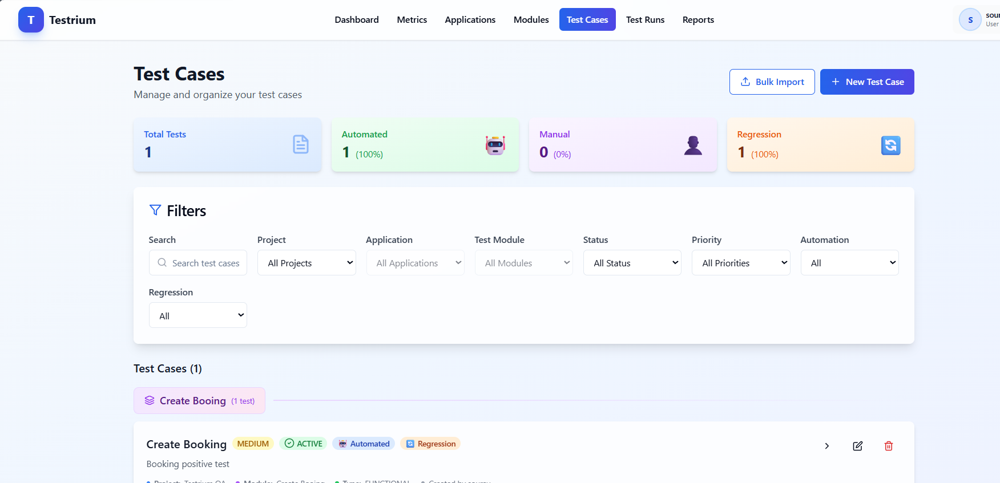
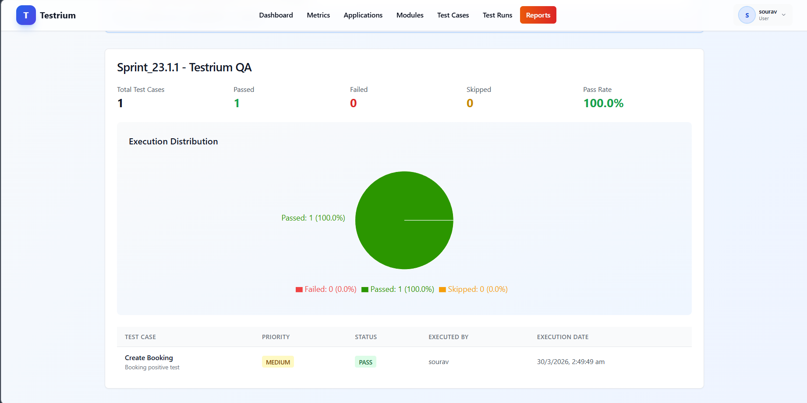

# Testrium

**Version:** 2.2.1
**A Comprehensive Test Case Management System**


[](./LICENSE.txt)


---

## Overview

Testrium is a modern, full-stack test case management system designed to streamline test planning, execution, and reporting for QA teams. Built with Spring Boot and React, it provides a comprehensive solution for managing test cases, executing test runs, tracking results, and generating detailed reports.

### Key Features

✅ **Test Case Management**
Create, organize, and maintain test cases with detailed steps and expected results.

✅ **Test Run Execution**
Execute tests individually or in bulk with real-time status tracking.

✅ **Bulk Operations**
Select and update multiple test results at once; bulk import and export test cases via Excel.

✅ **Tags & Labels**
Tag test cases (smoke, regression, critical…) and filter by tag.

✅ **Cross-Project Overview**
Aggregated KPIs and charts across all projects, scoped by role.

✅ **Notifications**
Per-project email (SMTP) and Slack / Microsoft Teams webhook notifications for test run events.

✅ **JIRA Integration**
Create bugs directly from failed test executions.

✅ **Test Data Management**
Centralized test data with environment-specific configurations.

✅ **Advanced Reporting**
Generate PDF/Excel reports with charts and visualizations.

✅ **Automation API**
RESTful API for integration with automation frameworks.

✅ **Role-Based Access**
Secure access control with user roles and permissions.

✅ **Dark Mode**
Full dark mode support across the application.

---

## Technology Stack

### Backend
- **Framework:** Spring Boot 3.2.0
- **Language:** Java 17
- **Database:** MySQL 8.0
- **Security:** Spring Security + JWT
- **Build Tool:** Maven 3.9+

### Frontend
- **Framework:** React 18.2
- **Build Tool:** Vite 5.4.21
- **UI Library:** Tailwind CSS
- **Icons:** Lucide React
- **Charts:** Recharts
- **HTTP Client:** Axios

---

## Quick Start (Docker — Recommended)

The easiest way to run Testrium is with Docker Compose. No Java or Node.js required.

### 1. Download the compose file

```bash
curl -O https://raw.githubusercontent.com/testrium/testrium/master/docker-compose.yml
curl -O https://raw.githubusercontent.com/testrium/testrium/master/.env.example
```

### 2. Configure environment

```bash
cp .env.example .env
# Edit .env and set your JWT_SECRET and DB passwords
```

### 3. Run

```bash
docker compose up -d
```

Open `http://localhost:8080`. On first start you'll see a setup screen where you create the admin account.

### Docker Image

| Image | Docker Hub |
|-------|-----------|
| Testrium (all-in-one) | `sddmhossain/testrium:latest` |

---

## Local Development Setup

### Prerequisites

- Java JDK 17+
- Node.js 18+
- Maven 3.9+

### 1. Backend

```bash
cd backend
mvn spring-boot:run
```

Backend starts at `http://localhost:8080` (uses H2 file DB by default).

### 2. Frontend

```bash
npm install
npm run dev
```

Frontend starts at `http://localhost:5173`

---

## What's New in Version 2.2.0

- **Cross-Project Overview** — a new Overview page with KPIs (projects, test cases, runs, members, pass rate), status/priority/automation charts, and a per-project breakdown. Admins see all projects; leads and members see their own.
- **Slack / Teams Notifications** — per-project webhooks for "test run assigned" and "test run completed", with test buttons in the UI.
- **Per-Project Email Notifications** — SMTP settings per project with encrypted password storage and a "send test email" button.
- **Export Test Cases to Excel** — exports the currently filtered test cases to a styled `.xlsx` file.

Version 2.1.0 added tags on test cases, cloning and editing of test runs. See [CHANGELOG.md](./CHANGELOG.md) for the full history.

---

## Documentation

| Document | Description |
|----------|-------------|
| [TESTING_GUIDE.md](./TESTING_GUIDE.md) | Complete guide for testing on different systems and environments |
| [AUTOMATION_API_GUIDE.md](./AUTOMATION_API_GUIDE.md) | API documentation for automation framework integration |
| [CHANGELOG.md](./CHANGELOG.md) | Version history and release notes |

---

## Project Structure

```
testrium/
├── backend/                    # Spring Boot backend
│   ├── src/
│   │   ├── main/
│   │   │   ├── java/com/testrium/
│   │   │   │   ├── controller/    # REST controllers
│   │   │   │   ├── service/       # Business logic
│   │   │   │   ├── repository/    # Data access
│   │   │   │   ├── entity/        # JPA entities
│   │   │   │   ├── dto/           # Data transfer objects
│   │   │   │   └── security/      # Security configuration
│   │   │   └── resources/
│   │   │       └── application.properties
│   │   └── test/
│   └── pom.xml
├── src/                        # React frontend
│   ├── components/            # Reusable components
│   ├── pages/                 # Page components
│   ├── services/              # API services
│   ├── contexts/              # React contexts
│   ├── api/                   # API configurations
│   └── App.jsx
├── public/
├── package.json
├── vite.config.js
├── tailwind.config.js
├── README.md
├── TESTING_GUIDE.md
├── AUTOMATION_API_GUIDE.md
└── CHANGELOG.md
```

---

## Core Modules

### 1. User Management
- User registration and authentication
- JWT-based security
- Role-based access control (ADMIN/USER)
- Password encryption and validation

### 2. Project Management
- Create and manage test projects
- Assign team members to projects
- Project-level access control
- Project statistics and metrics

### 3. Test Case Management
- Create detailed test cases with steps and expected results
- Organize by projects and modules
- Priority levels (Critical, High, Medium, Low)
- Search and filter capabilities
- Test case templates

### 4. Test Run Execution
- Create test runs from selected test cases
- Real-time execution tracking
- **NEW: Bulk status updates**
- Execution time recording
- Comments and actual results
- Progress visualization
- JIRA integration for bug creation

### 5. Test Data Management
- Environment-specific test data (DEV, QA, STAGING, PROD)
- Multiple data types (KEY_VALUE, JSON, CSV, XML)
- Centralized data repository
- API access for automation frameworks
- Search and filter by environment

### 6. Reports & Analytics
- Test execution reports with charts
- PDF export with pie charts
- Excel export with detailed data
- Custom report naming
- Trend analysis over time
- Pass/fail rate calculations

### 7. Dashboard & Metrics
- Real-time statistics
- Project-wise metrics
- Test execution trends
- Performance indicators

---

## API Integration

Testrium provides RESTful APIs for integration with automation frameworks like Selenium, RestAssured, Playwright, and more.

### Example: Fetch Test Data

```bash
curl -X GET "http://localhost:8080/api/automation/test-data/by-name?projectId=1&name=Login%20Credentials&environment=QA" \
  -H "Authorization: Bearer YOUR_JWT_TOKEN"
```

### Example Response

```json
{
  "id": 1,
  "name": "Login Credentials",
  "environment": "QA",
  "dataType": "KEY_VALUE",
  "data": "{\"username\":\"testuser@example.com\",\"password\":\"Test@123\"}"
}
```

For complete API documentation, see [AUTOMATION_API_GUIDE.md](./AUTOMATION_API_GUIDE.md)

---

## Configuration

### Docker Configuration (via `.env`)

All settings are controlled through environment variables. Copy `.env.example` to `.env`:

```env
# Database
MYSQL_ROOT_PASSWORD=changeme_root
MYSQL_DATABASE=testrium
MYSQL_USER=testrium
MYSQL_PASSWORD=changeme_db

# JWT (min 32 chars, use a strong random string)
JWT_SECRET=REPLACE_WITH_A_LONG_RANDOM_SECRET_STRING_HERE

# JIRA encryption key (must be exactly 16 characters)
JIRA_ENCRYPTION_KEY=TestriumJiraKey1

# CORS (your public domain in production)
CORS_ALLOWED_ORIGINS=http://localhost

# Optional: email / SMTP
MAIL_SMTP_HOST=smtp.gmail.com
MAIL_SMTP_USERNAME=
MAIL_SMTP_PASSWORD=
```

### Local Dev Configuration

For local dev, set in `backend/src/main/resources/application.properties` (H2 used by default, no MySQL needed).

---

## Building for Production

### Build Docker Image Locally

```bash
docker build -t sddmhossain/testrium:latest .
```

### Run with Docker Compose

```bash
docker compose up -d
```

### Manual Build (without Docker)

```bash
# Backend
cd backend
mvn clean package -DskipTests
java -jar target/testrium-2.2.1.jar

# Frontend
npm run build
npm run preview
```

---

## Deployment

### Docker Deployment (Recommended)

```bash
# Using docker-compose
docker-compose up -d
```

### Traditional Deployment

See [TESTING_GUIDE.md](./TESTING_GUIDE.md) for detailed deployment instructions for:
- Linux servers
- Windows servers
- Cloud platforms (AWS, Azure, GCP)
- Nginx configuration
- SSL setup

---

## Testing

### Run Backend Tests

```bash
cd backend
mvn test
```

### Testing Checklist

For comprehensive testing checklist, see [TESTING_GUIDE.md](./TESTING_GUIDE.md)

---

## Browser Support

- ✅ Chrome (latest)
- ✅ Firefox (latest)
- ✅ Edge (latest)
- ✅ Safari (latest)

---

## Screenshots

### Dashboard


### Test Cases


### Test Runs


### Reports with Charts


---

## Roadmap

### Recently shipped
- Per-project email notifications (2.2.0)
- Slack / Teams webhook notifications (2.2.0)
- Cross-project Overview dashboard (2.2.0)
- Excel export of test cases (2.2.0)
- Tags / labels, clone and edit test runs (2.1.0)
- JIRA integration and Automation API

### Next up
- Test case templates
- Test suites: reusable groups of test cases to start runs from
- Test case history: see who changed what, and when
- CI/CD result import: push automated results (e.g. JUnit XML) into a test run
- Scheduled / recurring test runs

### Later
- Multi-tenancy (organizations / workspaces)
- Advanced analytics: flaky-test detection and trend insights
- Real-time collaboration during test execution
- Mobile-friendly execution view

Want to help? Look for issues labeled [`good first issue`](https://github.com/testrium/testrium/labels/good%20first%20issue). See [CHANGELOG.md](./CHANGELOG.md) for the full version history.

---

## Troubleshooting

### Common Issues

**Port 8080 already in use:**
```bash
# Kill process or use different port
java -jar target/testrium-2.2.1.jar --server.port=8081
```

**Database connection failed:**
```bash
# Check MySQL is running
sudo systemctl status mysql
```

**CORS errors:**
- Update CORS configuration in SecurityConfig.java
- Add frontend URL to allowed origins

For more troubleshooting, see [TESTING_GUIDE.md](./TESTING_GUIDE.md)

---

## Contributing

Contributions are welcome! Please follow these steps:

1. Fork the repository: https://github.com/testrium/testrium.git
2. Create a feature branch (`git checkout -b feature/amazing-feature`)
3. Commit your changes (`git commit -m 'Add amazing feature'`)
4. Push to the branch (`git push origin feature/amazing-feature`)
5. Open a Pull Request

### Coding Standards

- **Backend:** Follow Java coding conventions
- **Frontend:** Use ESLint and Prettier
- **Commits:** Use conventional commit messages
- **Tests:** Write unit tests for new features

---

## Security

### Reporting Security Issues

If you discover a security vulnerability, please open an issue at https://github.com/testrium/testrium/issues instead of using email.

### Security Features

- JWT-based authentication
- Password encryption with BCrypt
- SQL injection prevention
- XSS protection
- CSRF tokens
- Role-based access control

---

## Support

For support and questions:

- **GitHub:** https://github.com/testrium/testrium
- **Documentation:** See guides in the repository
- **Issues:** Use GitHub Issues for bug reports

---

## License

Testrium is licensed under the [Apache License 2.0](./LICENSE.txt).

**Attribution is required.** If you fork, modify, rebrand or redistribute Testrium, you must keep the [`LICENSE.txt`](./LICENSE.txt) and [`NOTICE`](./NOTICE) files and credit the project, for example: *"Based on [Testrium](https://github.com/testrium/testrium), licensed under the Apache License 2.0."*

The Testrium name and logo are **not** covered by the license. Derivative tools must use their own name and branding. See the [Trademark & Attribution Policy](./TRADEMARKS.md).

---

## Acknowledgments

- Spring Boot team for the excellent framework
- React team for the powerful UI library
- Tailwind CSS for the utility-first CSS framework
- All contributors and users of Testrium

---

## Contact

**Project:** Testrium
**GitHub:** https://github.com/testrium/testrium
**Version:** 2.2.1
**Last Updated:** November 2026

---

Made with ❤️ for QA Teams
